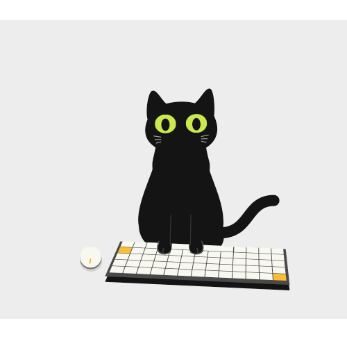
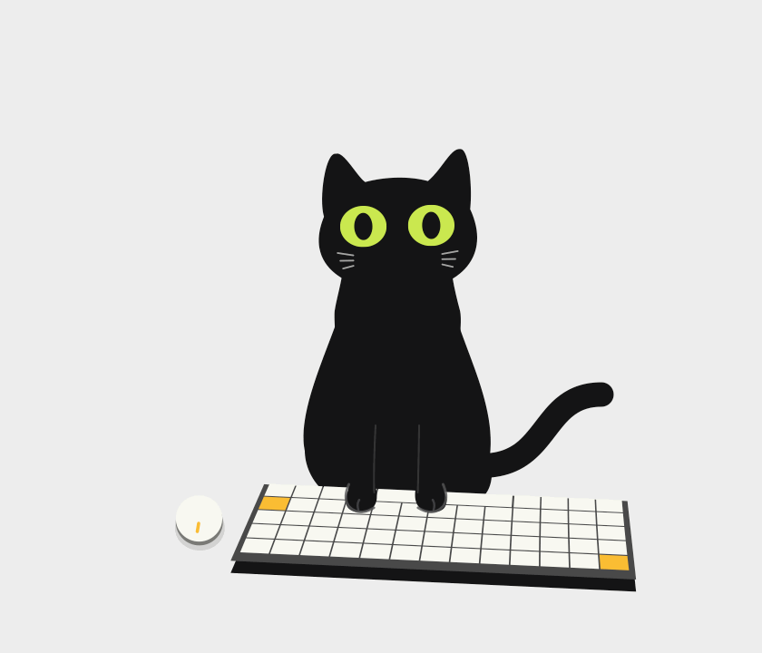

# 黑猫桌宠

一只坐在 Mac 桌面角落、和你共用键鼠的黑猫。你移动指针，它会探身握住自己的小鼠标；你敲键，它会把爪子落到键盘上。把指针轻轻放在两耳之间，它会眯起眼睛，朝你的手蹭过来。


## 在 Mac 上运行

从[项目介绍页](https://techfanseric.github.io/black-cat-desktop-pet/)看动作演示，或从 [GitHub Releases](https://github.com/techfanseric/black-cat-desktop-pet/releases) 下载打包好的 Mac 应用。解压后，把「黑猫桌宠」拖进「应用程序」并打开。通用包支持 Apple Silicon 和 Intel，最低系统为 macOS 13。此版本采用本地签名，未经 Apple 公证。

### 从源码构建

需要 macOS 13 或以上版本，以及带有 `swiftc` 和 `make` 的 Xcode Command Line Tools。首次配置开发工具可运行 `xcode-select --install`。下载或克隆本仓库后，在仓库根目录执行：

```sh
make app
open ".build/黑猫桌宠.app"
```

猫会出现在屏幕右下角。菜单栏的 **🐾** 可以切换姿态、演示动作、打开打字测试窗或退出。想换个位置，按住猫的身体拖动即可；头顶留给摸猫。打开「鼠标穿透」后，点击会落到后面的窗口。要重新拖动猫，从菜单栏关闭穿透。

不需要菜单栏图标时，在同一菜单选择「隐藏菜单栏图标」，设置会被记住。之后仍可**右键点击猫身**唤出同一个菜单，把图标找回来。

## 先试三个互动

1. **握鼠标**。让指针从屏幕左下慢慢走到右上，再沿原路返回。猫爪和小鼠标会一起移动，肩膀随之转移重心。屏幕中心对应活动范围中心，四角对应四个极限位置；多显示器使用整个扩展桌面的边界。停手后，猫会收爪，小鼠标留在松手的位置。
2. **摸猫头**。把指针放在两耳之间约三分之一秒，再慢慢左右移动。猫会眯眼、侧脸蹭手，尾巴轻摆。移开指针，眼睛会慢慢睁开。悬停就能触发。
3. **敲键盘**。打开 **🐾 → 打开打字测试窗…**，交替按 `F`、`J` 和 `Shift`，看爪子落下、键帽亮起、按键标签浮现。只想看一遍动画，可以选 **演示敲键效果**。



### 在其他应用中跟随打字

测试窗可以直接试用。要让猫在你使用编辑器等其他应用时也跟着敲键，选择 **🐾 → 键盘联动待启用…**，在 macOS 的「隐私与安全性 → 输入监控」中允许这个 `.app`。系统列表可能显示它的旧名称「奶牛猫桌宠」。如果列表里找不到它，用 `+` 添加刚构建的 `.build/黑猫桌宠.app`，按系统提示退出并重新打开。

菜单显示「键盘联动已启用」后，就可以回到其他应用试按。桌宠以只监听的方式读取按键码与修饰键状态，在内存中短暂保留用于动画的键名。**桌宠可见时，旁边的人或录屏也能看到浮出的键名**；可以从 🐾 菜单隐藏桌宠。

## 动耳、舔爪和抓痕



| 想看到的动作 | 怎么触发 |
| --- | --- |
| 动耳朵 | 把指针从猫的侧面移近，靠近你这一侧的耳朵会转一下。 |
| 舔爪子 | 让猫安静约 12 秒。它会抬爪到嘴边舔两下；中途有新的输入，它会放下爪子。 |
| 抓屏幕 | 在猫身旁短时间内左右来回逗弄，连续换向两次。它会伸爪划过，三道抓痕留在桌宠浮窗里，随后淡去。两次抓挠至少间隔 6 秒。 |

要单独重播其中一个动作，打开 **🐾 → 逗逗黑猫**。摸头适合在两耳间缓慢移动，想看抓痕则在脸旁幅度大一些地来回移动。

## 四种姿态

默认的「自动感知」会在以下姿态之间平滑过渡。也可以在 **🐾 → 黑猫姿态** 中固定喜欢的一款，选择会在下次启动时保留。

| 姿态 | 自动进入的时机 |
| --- | --- |
| A · 端坐 | 日常待机、打字或享受摸头时。 |
| B · 探身 | 持续移动鼠标、滚动或按住鼠标时。 |
| C · 警觉 | 快速甩动指针或快速双击时，眼睛短暂睁大。 |
| D · 困困 | 闲置约 35 秒后，眼皮慢慢垂下来。 |

## 开发与验证

猫、键盘和鼠标都由 Swift 和 Core Graphics 绘制。肩膀与身体共用一套坐标，前腿轮廓随爪尖目标变形。桌面的透视投影同时决定鼠标的位置和爪子的接触点。上面的 GIF 都由应用自己的渲染入口导出。

| 文件 | 从这里看什么 |
| --- | --- |
| `Sources/main.swift` | AppKit 浮窗、菜单、输入采样、屏幕位置映射和动图导出。 |
| `Sources/BlackCatBehavior.swift` | 四种姿态的混合、摸头判定，以及小动作的触发、打断和冷却。 |
| `Sources/BlackCat.swift` | 猫的轮廓、眼神、手臂变形、键鼠透视和抓痕绘制。 |
| `Tests/CheckCatBehavior.swift` | 姿态切换、空闲、摸头、抓挠与动作打断的测试。 |

在已登录图形桌面的 Mac 上运行 `make test`。测试先检查状态切换，再启动 AppKit 测试窗，验证屏幕四角与中间位置的映射、反向移动和敲键反馈。要重做 README 中的动图，运行：

```sh
make app
app=".build/黑猫桌宠.app/Contents/MacOS/MilkCat"
"$app" --render-touch docs/media/mouse-and-petting.gif
"$app" --render-motion docs/media/typing.gif
"$app" --render-gestures docs/media/gestures.gif
```
